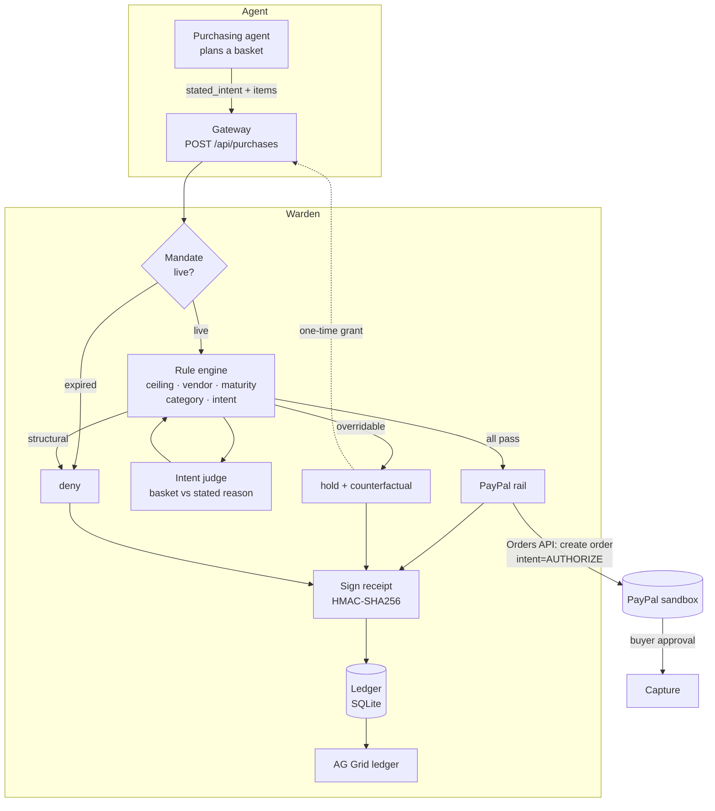
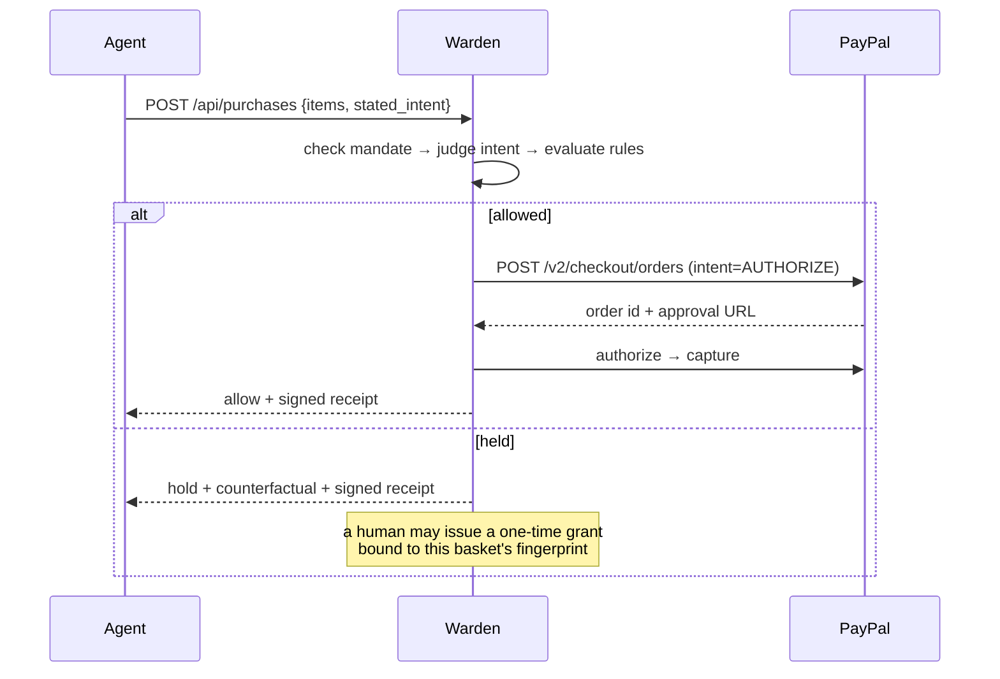

<div align="center">

# Warden

**Your agent has a spending limit. That is not the same as permission.**

Spend authority and proof receipts for AI agents that pay — built on the PayPal sandbox.

`PayPal Orders API` · `Authorize → Capture` · `AG Grid` · `MIT`

<sub>Independent entry to the PayPal AI Hackathon. Not affiliated with or endorsed by PayPal.
Sandbox only — no real money moves anywhere in this repository.</sub>

</div>

---

## The problem nobody has an answer to

An AI agent with a $500 ceiling will happily spend $480 on an espresso machine while reporting
that it is restocking printer paper. Every control that exists today — virtual cards, merchant
blocklists, per-transaction limits — answers **how much** and **who**. None of them answers *why*.

That gap is not theoretical. It is the exact shape of agent failure: the agent has not been
hacked, it has drifted, and it is still inside its limit. A card cannot see that, because a card
has never known what the purchase was *for*.

Warden does, because the agent has to say.

## Where it sits in PayPal's agent stack

PayPal already ships an [Agent Toolkit](https://github.com/paypal/AI-Toolkit) and an MCP server
exposing `create_order`, `pay_order`, `create_refund`, `list_disputes` and more. Those tools give
an agent **capability** — what it is able to do. Their own docs describe the `--tools` flag as
"useful for limiting the scope of the agent's permissions", which is tool-level scoping.

Warden adds the two dimensions a tool flag cannot express:

1. **Intent authority** — not *may this agent call `pay_order`*, but *does this specific payment
   match the reason the agent gave for making it*.
2. **Proof** — a signed record of the decision that a third party can verify without the agent,
   the ledger, or us.

It is complementary to the Toolkit, not a replacement: put Warden in front of the PayPal tools and
they inherit authority and evidence.

## See it prove itself

Open the ledger, press **Tamper demo**. Two verdicts on the same receipt, one field apart:

```
VALID     as signed          signature valid
INVALID   one field flipped  signature does not match payload - receipt was modified or the key is wrong
```

Click any row to re-verify its signature. The altered copy is never stored — the demo returns both
results side by side and leaves the real receipt untouched.

## Where the AI actually is

Four model jobs, three of them agentic — the model acts, sees what happened, and acts again:

| # | Job | Agentic because |
|---|---|---|
| 1 | **Negotiate** a price with a merchant agent (`negotiate.py`) | Multi-round: proposes, reads the counter, re-proposes, and **walks away** rather than breach its ceiling |
| 2 | **Repair its own refusal** (`remediate.py`) | Reads the counterfactual from a held decision, changes the basket, resubmits, observes again |
| 3 | **Judge intent** (`intent.py`) | Scores the basket against the agent's stated reason and must cite the evidence |
| 4 | **Plan the purchase** (`agent.py`) | Turns a goal into a basket, which is then judged like anyone else's |

```
plan → negotiate → attempt → HOLD(reason + counterfactual) → revise → attempt → ALLOW → receipt
```

Every arrow after `attempt` is a model reacting to a consequence, not producing text. That is the
difference between an AI feature and an AI actor.

**The fence under it is deliberately deterministic.** Rules, thresholds, fingerprints and
signatures are plain code, because a control a persuasive counterparty can talk around is not a
control. The model writes the message; the mandate decides the number.

## What it does

Before an agent can spend, it is given a **mandate**: one purpose, one ceiling, a category scope,
a minimum payee age, and an expiry. When the agent attempts a purchase, Warden checks the basket
against the mandate **and against the reason the agent gave for buying it**.

Three outcomes, not two:

| | |
|---|---|
| **allow** | every rule passed — the payment is authorised through PayPal |
| **hold** | a human could reasonably say yes — the payment waits, with the exact reason |
| **deny** | the mandate cannot authorise this at all — a new mandate is needed |

And every decision, paid or refused, is a **signed receipt** you can re-verify later.

### The four things that make it different

**1. Intent binding.** The agent states why it is buying. An LLM judge scores the basket against
that statement and must cite the evidence it used. 480.00 of espresso under a 500.00 ceiling is
*held*, because the stated intent was printer paper.

**2. Every hold carries a counterfactual.** Not "policy violation" — *"534.00 is 34.00 over the
500.00 ceiling; remove 34.00 of goods, or approve this one purchase."* A refusal nobody can act on
is indistinguishable from a bug, and it trains people to click approve without reading.

**3. Grants, not raised ceilings.** Releasing a held basket issues a one-time grant bound to the
**fingerprint of that basket**. It cannot be reused for the next thing the agent wants to buy. A
raised limit is a permanent widening; approving one purchase is not.

**4. Receipts, not logs.** Every decision is canonicalised, HMAC-SHA256 signed, and stored. `GET
/api/decisions/{id}/verify` recomputes the signature. Change one field of a receipt and it fails —
try it, the offline demo does exactly that at the end.

## The agent is deliberately boring

The shopper in this repository is the least interesting part of it, on purpose. Any tool-calling
loop, LangGraph node, or cron job is supposed to call the same endpoint. The guard does not trust
its own agent — that is the entire architecture.

## Architecture





## Run it in thirty seconds

No PayPal account, no API key, no network — the whole rule engine runs offline:

```bash
git clone https://github.com/RANJITHROSAN17/warden
cd warden
python -m pip install -e .
python -m warden.demo
```

Real output from that command:

```
WARDEN  -  spend authority for AI agents
------------------------------------------------------------------------------
mode      simulated   (labelled stand-in; set PayPal sandbox credentials for real calls)
mandate   mnd_3aeaf4004e  Q4 office restock
ceiling   500.00 USD   categories ['office_supplies']   vendor age ≥ 30d
judge     lexical-overlap
------------------------------------------------------------------------------

ALLOW  1 restock paper               56.00 USD  intent 0.65
       paypal    SIM-ORDER-AB62C5B3DFC3 → SIM-AUTH-8B75C51E8931

HOLD   2 drift, same ceiling        480.00 USD  intent 0.00
       because     category.scope: categories outside scope: electronics
                   intent.binding: intent match 0.00 below threshold 0.55 (matched nothing; intent mentions office, paper, printer, restock which the basket does not contain)
       would need  remove electronics items or widen the mandate's scope
       decision    dec_65dae8be0cab

HOLD   3 over ceiling               534.00 USD  intent 0.59
       because     mandate.ceiling: 534.00 USD is 34.00 over the 500.00 ceiling
       would need  remove 34.00 USD of goods, or approve this one purchase
       decision    dec_7275526ab880

HOLD   4 new vendor                  30.00 USD  intent 0.61
       because     vendor.approved: vendor V-FRESH is not an approved payee
                   vendor.maturity: vendor is 12 days old; mandate requires 30
       would need  add V-FRESH to this mandate's allowed vendors
       decision    dec_fd77d6c9990c

ALLOW  5 same basket, granted       534.00 USD  intent 0.59
       paypal    SIM-ORDER-75C991FF7882 → SIM-AUTH-939497782C94

ALLOW  6 authorised, then voided     30.00 USD  intent 0.61
       authorised  SIM-AUTH-F22B72E8486A   money not taken yet
       voided      SIM-AUTH-F22B72E8486A   (simulated)
       because     the mandate was revoked after authorisation; the authorisation
                   window is what makes that possible without a refund

------------------------------------------------------------------------------
allowed 3   held 3   denied 0
------------------------------------------------------------------------------
verify dec_ccdfaaa21887  →  True  (signature valid)
verify tampered receipt  →  False  (signature does not match payload - receipt was modified or the key is wrong)

Every decision above, paid or refused, is a signed receipt:
  python -m warden.cli serve   →   http://127.0.0.1:8000/
```

<sub>Ids and hashes vary per run; every decision, rule and gate is deterministic.</sub>

### Two agents negotiate

```bash
python -m warden.demo --story negotiate
```

```
seller    534.00 USD  listed price
buyer     440.00 USD  I can commit 440.00 USD. That is my budget for 6 x toner cartridges.
seller    505.00 USD  Best we can offer is 505.00 USD; costs have moved.
buyer     470.00 USD  ...
buyer   walk away     seller's floor 505.00 USD is above the mandate ceiling 500.00 USD
```

The buyer does not concede past its limit — it negotiates a **smaller basket** instead (445.00,
allowed). And if it had settled at 534 anyway, the rules would have held it. The negotiation is the
model's; the ceiling is not.

### The agent repairs itself

```bash
python -m warden.demo --story heal
```

Plans 658.00 against a 200.00 mandate → held → reads the counterfactual → drops the out-of-scope
electronics → restates an inaccurate intent → pays 178.00 through the same six rules. Three
receipts chain the intent change, so the rewrite is visible rather than settled.

### The second story: paying for work, not goods

```bash
python -m warden.demo --story payout
```

A contractor's job is marked complete and the payment goes out. Then the same contractor bills a
full order where one deliverable was never handed over — and the engine holds it, because the
**evidence** field disagrees even though the agent's own claim does not. Same engine, different
domain.

### The ledger

```bash
python -m pip install -e ".[server]"
python -m warden.cli serve          # http://127.0.0.1:8000
```

Press **Run the five scenarios**. AG Grid renders every decision with its outcome, the rule that
decided it, the intent score and the receipt id. Filter `outcome = hold` to see the complete list of
things the agent wanted to buy and was stopped from buying — which is the report a finance team
actually wants and cannot get from a card statement.

### Against the real PayPal sandbox

```bash
cp .env.example .env      # add sandbox client id + secret
export $(grep -v '^#' .env | xargs)

python -m warden.cli preflight        # which rail will run, and whether the key works
python -m warden.demo --rail sandbox  # the six scenarios against real PayPal calls
python -m warden.cli serve
```

`preflight` exists because a wrong client id and a wrong environment both present as the same
confusing failure minutes into a demo. `--rail sandbox` **errors** rather than falling back to the
simulator: a demo that quietly degrades from a real call to a fake one would be the exact failure
this project exists to catch.

The rail switches to `sandbox` and calls `POST /v2/checkout/orders` with `intent=AUTHORIZE`,
returning PayPal's own approval URL. Approving it as the sandbox buyer, then capturing, is the
authorization → capture flow the product is built around.

## How it was built

| Layer | Choice | Why |
|---|---|---|
| Rule engine | Plain Python, zero dependencies | A guard you cannot read is a guard you cannot trust. `src/warden/policy.py` is ~200 lines |
| Intent judge | Pluggable: deterministic lexical, or any OpenAI-compatible model | The receipt records which one produced the score, so a model outage cannot silently change the evidence |
| Payments | PayPal Orders API v2 (`intent=AUTHORIZE`) + Payments API capture/void | The authorization window is the product: authorise now, decide before capture |
| Receipts | Canonical JSON + HMAC-SHA256 | Verifiable by a third party without trusting the database |
| Storage | SQLite | An audit trail should survive the process that wrote it |
| UI | AG Grid (community) | The ledger is the product surface: dense, filterable, auditable — not a chart |
| API | FastAPI + an OpenAPI 3.1 document | `openapi.yaml` is the SDK-generation input; the server holds no policy logic of its own |

## What is real and what is simulated

Being exact about this is the point of the project, so it should apply to the README too.

| Component | Status |
|---|---|
| Rule engine, intent judge, grants, receipts | **Real** — running in the demo above |
| PayPal calls | **Real HTTP** in `sandbox` mode; a clearly-labelled deterministic stand-in in `simulated` mode. Every receipt and every ledger row carries `mode` |
| Intent judge | Lexical judge by default (deterministic, offline). Model judge when `WARDEN_LLM_API_KEY` is set |
| Receipt signing | HMAC-SHA256 with a key from the environment. **Production needs asymmetric signing or a KMS** |
| Webhook verification | Not implemented in this build. A real deployment must verify `PAYPAL-TRANSMISSION-SIG` |
| Vendor age / approval | Supplier data is a local catalogue in `catalog.py`. Production would read a vendor master |

### Why the flow authorises before capturing

The sixth scenario does something a capture-first flow cannot: it authorises a payment and then
voids it, because authority was withdrawn in between. The money never moves, so there is no refund
to chase and no dispute to win. That authorisation window is not an implementation detail — it is
the space in which a hold can exist at all.

## Challenges

**Deciding what "hold" means.** An early version returned allow/deny, and every soft case felt
wrong: a $34 overshoot is not fraud, but it is not permission either. Splitting out `hold` — and
requiring every hold to carry a counterfactual — is what made the product usable.

**Making the intent judge honest.** The interesting risk is not that the judge is wrong, it is that
the judge is *quietly* swapped. So the judge's name and model id are recorded inside the signed
payload. If you rerun a decision with a different judge, the receipts differ, visibly.

**Preventing grants from becoming ceilings.** The first design let a human approve a held payment,
which immediately became "approve all". Binding the grant to the basket fingerprint fixed it: the
approval is not transferable, so the second espresso machine is held again.

**Not faking the payment.** It would have been easy to print `✓ paid` and move on. Instead the rail
labels itself, and the simulator is a separate class with the same interface, so a simulated receipt
can never be mistaken for a sandbox one.

## What is next

- Webhook verification, so a settled payment can be closed out without polling.
- Asymmetric receipt signing with a published public key, so a third party can verify without a shared secret.
- A vendor-risk feed, replacing the local `catalog.py` with a real supplier master.
- Delegation: a human grants a *narrower* mandate to a sub-agent, and the chain of authority is recorded end to end.

## Sponsor tools

- **AG Grid** — the authorization ledger. Grouping, quick filter and a receipt drill-down on every row.
- **APIMatic** — `openapi.yaml` is the generation input for typed SDKs, so an agent framework can call Warden without hand-written HTTP.
- **Render** — the hosted demo runs `uvicorn warden.api:app` with `WARDEN_DB` pointing at a mounted disk.

## Licence

MIT. See [LICENSE](LICENSE).

<div align="center"><sub>Built for the PayPal AI Hackathon. Sandbox only — no real money moves anywhere in this repository.</sub></div>
