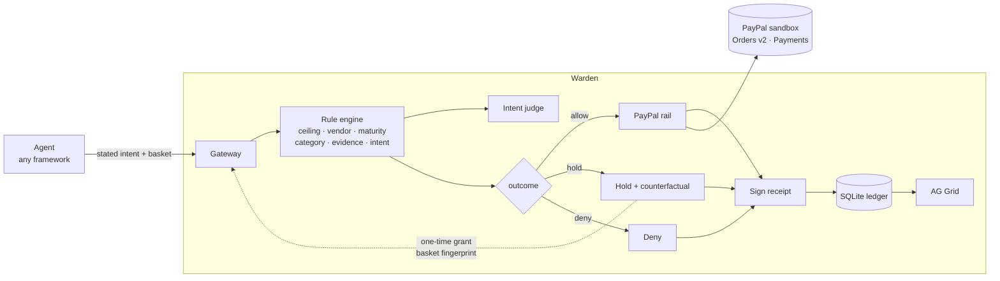

# Warden — final product specification

Version 1.0 · 28 Oct 2026 · written against the PayPal AI Hackathon resource list, the five
inspiration buckets, and the official rules PDF.

---

## 1. One sentence

**Warden is the authority layer between an AI agent and PayPal: the agent cannot move money until
it has said why, and every decision — paid, held, or refused — comes back as a receipt you can
verify.**

## 2. Why this, given what PayPal asked for

PayPal's brief asks for things "nobody's built yet" across agents, money movement, business tools,
consumer experiences and social impact. Four of their own statements decide the shape of this
product:

| PayPal's own words | What it means for the spec |
|---|---|
| "There are no prescribed problem statements… your project must meaningfully use both PayPal and AI" | The PayPal integration has to be structural, not decorative. Ours is the payment rail itself |
| Inspiration: *"two agents negotiating and settling a payment between themselves (agent-to-agent commerce)"* | Agent-to-agent settlement is explicitly invited. That is our primary story |
| Inspiration: *"a scheduling assistant that pays contractors automatically when a job is marked complete"* | Our second story, almost word for word |
| Seller Protection guidance, Apr 2026: *"PayPal does not assess AI intent or behavior"* | The gap we fill, in PayPal's own sentence |

**Where Warden sits against PayPal's agent stack — this is the important bit.**

PayPal already ships an Agent Toolkit and an MCP server exposing `create_order`, `pay_order`,
`create_refund`, `list_disputes`, `create_invoice` and more. Those tools give an agent
**capability**: *what it is able to do*. Their own documentation says the `--tools` flag is "useful
for limiting the scope of the agent's permissions" — that is tool-level scoping.

Warden adds the two dimensions a tool flag cannot express:

1. **Intent authority** — not *may this agent call pay_order*, but *does this specific payment
   match the reason the agent gave for it*.
2. **Proof** — a signed record of the decision that a third party can verify without the agent,
   the ledger, or us.

That framing should be held in every demo, README and form answer: **Warden is complementary to
the PayPal Agent Toolkit, not a replacement for it.** We are the layer between the agent and the
tool.

## 3. Personas

| Persona | What they do today | What hurts | What Warden gives them |
|---|---|---|---|
| **Platform engineer** shipping an agent that spends | Writes tool-calling code, hopes the prompt holds | Cannot answer "what is it allowed to buy, and can you prove it stayed inside the line?" | A mandate object + an endpoint that returns allow/hold/deny with a receipt |
| **Finance / ops at that company** | Virtual card with a limit; a monthly statement | Agent spend is invisible until it is spent, and the statement says `$534 — ACME OFFICE SUPPLY` and nothing else | Filterable ledger of every attempt with the reason, plus the ones that were stopped |
| **Marketplace / platform paying sellers** | Payouts via batch files, disputes via support tickets | Paying for work that was not delivered is expensive to unwind | Delivery-evidence rule: a billed line must point at an artefact |
| **Judge / reviewer** | Has fifteen minutes and a repo | Needs to see a real PayPal call | `preflight`, `--rail sandbox`, six scenarios, receipt verification |

## 4. What the product does — the four mechanics

Each one exists because the obvious alternative fails.

**4.1 Mandate — bounded authority.**
`purpose, ceiling, currency, allowed categories, minimum payee age, allowed vendors, intent
threshold, expiry, issuer.` An agent cannot attempt a payment without one. Alternative rejected:
*"set a spending limit"* — a limit has no purpose, no scope and no expiry, so it cannot say no.

**4.2 Intent binding — the reason is a rule.**
The agent states why it is paying. A judge scores the basket against that statement and must cite
evidence. The score is a thresholded, blocking rule in the same engine as the ceiling. Alternative
rejected: *"flag it for review"* — advisory flags are ignored, because nothing happens if you
ignore them.

**4.3 Evidence binding — proof that isn't prose.**
For work rather than goods, a billed line must carry an artefact (a PR, a commit, a signed file).
This exists because of a real failure the engine had: an agent that bills a deliverable it never
delivered passes intent binding, because its *claim* and its *basket* agree. Evidence is the one
input the agent does not author. Alternative rejected: *"trust the completion claim"* — that is
the thing being tested.

**4.4 Receipts — decisions you can check later.**
Canonical JSON → HMAC-SHA256 → stored. `GET /api/decisions/{id}/verify` recomputes it. The
receipt records the mandate fingerprint, every rule with its verdict, the intent score and its
evidence, the judge's identity, and the sandbox mode. Alternative rejected: *"log it"* — a log is
a claim by the system that produced it.

Plus the three outcomes (`allow` / `hold` / `deny`), the **counterfactual** on every failure, and
the **one-time grant** that releases exactly one held basket by fingerprint.

## 5. PayPal surfaces — what we use and why

| Surface | Where | Why it is the right one |
|---|---|---|
| **Orders API v2**, `intent=AUTHORIZE` | `paypal.SandboxPayPal.create_order` | The authorisation window is the product. It is the only state in which money is committed but not taken, so a hold can exist at all |
| **Payments API** capture / void | `capture()`, `void()` | Capture on approval; void when authority is withdrawn after authorisation. A capture-first flow cannot do the second |
| **Agent Toolkit / MCP server** *(`create_order`, `pay_order`, `list_disputes`)* | Planned wrapper, §9 | Use PayPal's own agent surface rather than re-implementing it. The strongest possible answer to "does this meaningfully integrate PayPal" |
| **Disputes API** (`list_disputes`, `get_dispute`) | Escalation panel, §9 | When a held payment becomes a disagreement, hand the party the receipt *and* the dispute status in one screen |
| **Webhooks** (signature-verified) | §9, first increment after the draft | A capture confirmation should arrive as an event, not a poll |
| **JS SDK / Buttons / Payment Links** | Not used | The buyer is an agent, not a human with a browser. Using a checkout button would be theatre — say so rather than bolt it on |
| **Payouts, Subscriptions, Invoicing, Pay Later, Donations** | Not used in v1 | Named here so the omission is a decision, not an oversight. Payouts is the natural v2 rail for the contractor story |

## 6. Where the AI is — and why it is visible

PayPal's brief asks what happens "when you put AI behind the wheel". It is worth being precise
about which wheel, because a rules engine with one classifier bolted on does not answer that
question.

Warden runs **four distinct model jobs**, and three of them are agentic — the model acts, observes
the consequence, and acts again:

| # | Job | Where | What makes it agentic |
|---|---|---|---|
| 1 | **Negotiate a price** with a merchant agent | `negotiate.py` | Multi-round: proposes, reads the counter, re-proposes, and walks away rather than breach its ceiling |
| 2 | **Repair its own refusal** | `remediate.py` | Reads the counterfactual from a held decision, changes the basket, resubmits, observes again — up to three attempts, never outside the rules |
| 3 | **Judge intent** | `intent.py` | Scores the basket against the agent's stated reason and must cite the evidence |
| 4 | **Plan the purchase** | `agent.py` | Turns a goal into a basket, which is then judged like anyone else's |

The loop that matters for "AI behind the wheel":

```
plan → negotiate → attempt → HOLD(reason + counterfactual) → revise → attempt → ALLOW → receipt
```

Every arrow after `attempt` is the model reacting to a consequence rather than producing text. That
is the difference between an AI feature and an AI actor.

**And the fence is deliberately deterministic.** Rules, thresholds, fingerprints and signatures are
plain code, because a control that a persuasive counterparty can talk around is not a control. The
model writes the message; the mandate decides the number. Saying that out loud is stronger than
pretending everything is a model.

### 6b. AI surfaces — the original breakdown

| Job | Where | Model | Failure mode if it is wrong |
|---|---|---|---|
| **Negotiation** — arguing a price across rounds | `negotiate.ModelBuyer` | Any OpenAI-compatible endpoint; deterministic negotiator as fallback | A deal above the ceiling; caught by the rules before any PayPal call |
| **Remediation** — repairing a refused basket | `remediate.py` | Deterministic logic on structured refusals | Wearing the gate down by retrying; capped at three attempts, and four refusal types are unfixable by design |
| **Judging intent** — does the basket match the stated reason | `intent.ModelJudge` | Any OpenAI-compatible endpoint; deterministic lexical judge as fallback | A wrong score holds a good payment (recoverable by grant) or allows a drifted one (caught by the evidence and category rules) |
| **Planning the purchase** — turning a goal into a basket | `agent.plan` | Same endpoint | A silly basket; still judged by the same rules. The agent is not trusted |
| **Explaining the refusal** — one sentence a human can act on | Template text today; model-assisted later | — | Vague refusals train people to click approve without reading, which is the failure being prevented |

Rule: **the judge's identity is recorded inside the signed receipt.** Change the model and the
receipt changes. This is what makes the AI's contribution auditable instead of asserted.

## 7. Architecture



Storage: SQLite. API: FastAPI + `openapi.yaml` (9 paths, 7 schemas). UI: AG Grid + a plain-table
fallback.

## 8. The four demo stories

**Story A — the agent that drifts (purchase).** Six scenarios: a normal restock (allow), a $480
espresso machine under a $500 ceiling (hold, intent 0.00), an over-ceiling order (hold, 34.00
over), a brand-new payee (hold), the same basket released by a one-time grant (allow), and an
authorised payment voided after the mandate was revoked (allow → void, money never moves).

**Story B — paying for work (payout).** `python -m warden.demo --story payout`. A complete work
order is paid; then the same contractor bills a full order where one deliverable was never handed
over. The claim and the basket agree — and it is **held on evidence**, not on prose. This is the
scenario that maps to PayPal's own "pays contractors when a job is marked complete".

**Story C — two agents negotiate (Agent→Agent commerce).**
`python -m warden.demo --story negotiate`. A buyer agent and a merchant agent argue over six toner
cartridges. The seller's floor is 505.00, the mandate ceiling is 500.00, so the buyer climbs
440 → 470 → 485 → 492.50 → **walks away**. It does not concede past its limit. Then it negotiates a
smaller basket at 445.00 and Warden allows it. Closing line: *a model that can talk its way past a
limit is not a control.*

**Story D — the agent repairs itself.**
`python -m warden.demo --story heal`. The agent plans 658.00 of espresso machine and toner against
a 200.00 mandate. Hold. It reads the counterfactual, drops the out-of-scope electronics, then
restates a genuinely inaccurate intent, then pays 178.00. Three receipts, and the intent change is
visible in the chain — which is why the chain is the evidence. Then an unapproved vendor: no
revision attempted, loop stops, human needed.

All four stories run offline, produce verifiable receipts, and are the same engine.

## 9. Scope, in three buckets

**Ships now (done, in the repo today)**
Mandate, six rules, intent binding, evidence binding, three outcomes, counterfactuals, one-time
grants, HMAC receipts + verify, SQLite ledger, REST API, OpenAPI 3.1 doc, AG Grid ledger,
`preflight`, `--rail` with no silent fallback, 18 tests, CI on 3.10–3.13, MIT.

**Ships before the 5 Nov draft (in priority order)**
1. `docs/sandbox-run.md` — a committed transcript of one real sandbox run, ids redacted.
2. **Webhook signature verification** — `PAYPAL-TRANSMISSION-SIG` checked, so a capture
   confirmation is an event rather than a poll. Do not claim webhooks until this exists.
3. **MCP server wrapper** — expose two tools, `warden.request_payment` and
   `warden.verify_receipt`, so any MCP client (Claude, Cursor, the PayPal Agent Toolkit) can put
   Warden in front of its PayPal tools.
4. **Disputes panel** — `list_disputes` alongside a held decision, so a refusal and a dispute live
   on one screen.

**Before 12 Nov**
Hosted demo on Render with real sandbox credentials; APIMatic-generated client committed from
`openapi.yaml`; the video; README polish.

**Explicitly out of scope**
Payouts, Subscriptions, Invoicing, Pay Later, Donations, JS SDK checkout, multi-tenant auth,
asymmetric signing, a vendor-risk feed. Each is a v2 line, not a gap.

## 10. Definition of done for the submission

- [ ] A judge who clones the repo runs one command and sees six decisions and a verified receipt
- [ ] A judge who opens the hosted URL sees the same ledger with `sandbox` in the header
- [ ] `python -m warden.cli preflight` prints `rail sandbox` on the demo machine
- [ ] At least one receipt in `docs/sandbox-run.md` shows real `PAYPAL-` ids
- [ ] The video shows a PayPal approval page, not a mock
- [ ] Every claim in the README maps to a file, a command, or a signed receipt
- [ ] No credential committed; CI scans for credential shapes
- [ ] MIT visible in the About panel; "not affiliated with PayPal" stated

## 11. Risks

| Risk | Likelihood | Mitigation |
|---|---|---|
| Judge runs the offline demo and sees only `simulated` | **High** | Hosted demo + sandbox video + committed transcript. `preflight` makes the mode impossible to miss |
| "PayPal could build this" | Medium | Answer in `docs/why-paypal.md`: their published documents name the gap; this is a working instance, and the enforcement point is a legitimate place for an independent layer |
| Intent judge is judged as unreliable | Medium | It is one rule among six, its evidence is cited, its identity is in the receipt, and a human grant path exists. Say the failure rate out loud |
| Scope creep before the deadline | **High** | §9 buckets are closed. A new idea goes to v2 unless it displaces an item in bucket two |
| Agent Toolkit integration breaks | Medium | Warden's REST path is standalone; the MCP wrapper is additive, never a dependency |

## 12. Which prizes this targets

| Prize | Why it is realistic |
|---|---|
| **Best Use of Agentic Commerce** | The product *is* an authority layer for agent-initiated payment; the payout story is literally their inspiration bullet |
| **Best Use of PayPal + AI** | Orders API + Agent Toolkit + Disputes, with AI making the decision no rule can |
| Overall (Technological Implementation) | Working engine, 18 tests, real sandbox calls, verifiable receipts |
| **AG Grid** | The ledger is the product surface and is load-bearing, not a chart |
| **APIMatic** | `openapi.yaml` is the generation input; a committed generated client is required before claiming it |
| Most Impactful / Most Creative | Plausible, not gamed — the honest pitch is "infrastructure for a market that is forming" |

Not targeted: Render (credits), Bryntum, Channel3, Elastic, KERNEL, Zapier, Astropods — no honest
role for them here.
